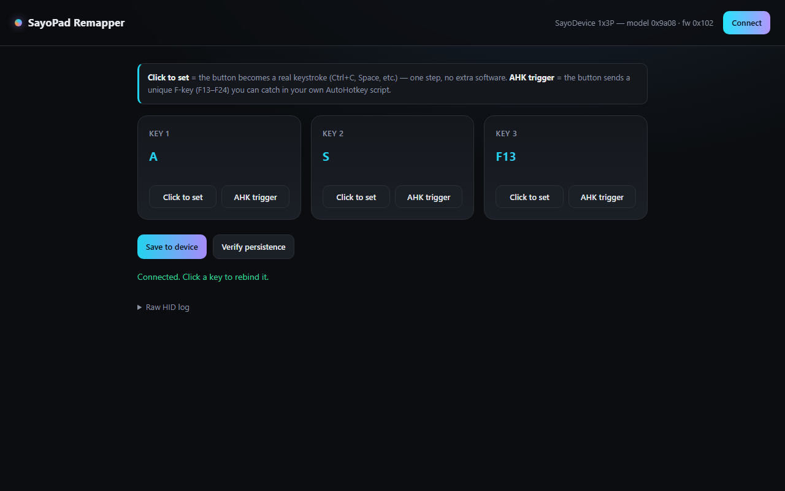

<p align="center"><a href="https://kitsunetechnologies.org/work"></a></p>

# MacroPad Local

Remap a SayoDevice macro pad from a browser UI with a small local HID agent.

[](LICENSE)




## Features

- Read and rebind all 3 keys on the pad over USB HID
- **Click to set** - press any single key (letters, digits, punctuation, function keys, arrows, numpad) and the pad sends that keystroke. Modifier combinations are not stored.
- **AHK trigger** - assign one of F13-F24 so your own AutoHotkey script can catch it, for combos this analog firmware can't do on its own
- **Save to device** - commits all 3 bindings to the pad's onboard flash
- **Verify persistence** - writes a sentinel key, has you unplug/replug the pad, and tells you whether your firmware actually keeps flash writes across a power cycle
- Raw HID log panel showing every TX/RX packet, for debugging the wire protocol

## Run it yourself

### What you need

- **A SayoDevice 1x3P macro pad**, plugged into a USB port (it's identified by USB vendor ID `0x8089`, you don't need to do anything with that number, the agent finds it automatically).
- **Python 3.8 or newer.** Check with `python --version` in a terminal. If that errors or shows Python 2, get it from https://python.org/downloads. During install, check the box that says **"Add python.exe to PATH"**, it's easy to miss and things won't work without it.
- **The `hidapi` Python package.** You don't need to install this by hand, `start.bat` installs it for you the first time you run it. If you're running `agent.py` directly instead, install it with `python -m pip install hidapi`.
- **Any browser** - Chrome, Firefox, Edge, and Safari all work. The Python agent does the USB communication, so the browser limitation that normally restricts this to Chrome doesn't apply here.

### Step by step

**Getting the files**

If you have git, clone it:

```powershell
git clone https://github.com/KitsuneTech1/kitsune-macropad.git
cd kitsune-macropad
```

If you don't have git, click the green **Code** button on this repo's GitHub page, then **Download ZIP**, then right-click the downloaded zip and choose **Extract All**, then open the extracted `kitsune-macropad` folder.

**Running it**

1. Plug in the SayoDevice 1x3P pad.
2. Double-click **`start.bat`**.
3. The first time you run it, a black terminal window will briefly say "Installing hidapi (one time)..." and install a small Python package. This is normal and only happens once.
4. The window will then print `Starting MacroPad Local on http://localhost:17890 ...` and stay open. Leave it open, it needs to keep running while you use the tool.
5. Your browser should open automatically to `http://localhost:17890`. If it doesn't, open your browser yourself and go to that address.
6. Click **Connect**. The page should say the pad is connected.
7. For each key, click **Click to set** and then press the key you want that pad button to send, or use **AHK trigger** to assign an F13-F24 key for your own AutoHotkey script to catch.
8. Click **Save to device** to write your changes to the pad's onboard memory.

**It worked if:** the page says Connected after step 6, and after **Save to device** your pad actually sends the new key when you press it.

To stop the agent, click back into the black terminal window and press `Ctrl+C`, or just close the window.

**Troubleshooting**

- *`python` is not recognized* (Windows opens a Microsoft Store page instead of running it): Python isn't installed, or wasn't added to PATH during install. Reinstall from https://python.org/downloads and check "Add python.exe to PATH."
- *"No SayoDevice found (VID 0x8089). Is it plugged in?"*: unplug and replug the pad, try a different USB port, and make sure no other program (like the manufacturer's own configuration app) has it open at the same time.
- *"Device did not respond (timeout)"*: unplug and replug the pad and click Connect again. If it keeps happening, try a different USB port or cable.
- *"Could not install hidapi"*: open a terminal in the project folder, run `python -m pip install hidapi`, then run `start.bat` again.
- *The browser never opens / can't reach localhost:17890*: make sure the black terminal window from `start.bat` is still open and didn't show an error. Some antivirus or firewall software blocks local Python servers, if that's the case, allow `python.exe` through it.

## How it works

Raw USB HID access from a browser normally means WebHID, and WebHID only works in Chromium. This project skips that limit: `agent.py` is a small local Python process that opens the pad directly with `hidapi` and exposes a JSON API on `http://localhost:17890` (`/api/connect`, `/api/keys`, `/api/key`, `/api/save`). The static page (`index.html`, `ui.js`, `client.js`) talks to that API over `fetch`, so the same UI works in any browser, not just Chrome.

The 1x3P is a hall-effect (analog) pad. Its per-key config is a 46-byte structure holding actuation and calibration data; the tap keycode lives at a fixed offset inside it. The agent reads the whole structure, edits only the keycode bytes, and writes it back, so your actuation tuning is never disturbed.

Because the UI depends on the local agent for every action (connect, read, write, save), it isn't hosted as a static site. Run it locally with `start.bat` or `python agent.py`.

## Tests

The tests run locally and do not need a SayoDevice, browser, or network access.

```powershell
python -m pytest -q
npm test
python -m compileall -q agent.py
```

## Files

- `agent.py` - local HID agent: USB protocol, localhost JSON API, static file server
- `index.html`, `styles.css` - UI markup and styling
- `ui.js` - UI logic and state
- `ui-utils.js` - safe status message rendering
- `save-logic.js` - guarded write and flash-save workflow
- `diagnostic.js` - persistence diagnostic workflow
- `client.js` - localhost API client
- `keymap.js` - HID keycode tables
- `start.bat` - Windows launcher

## License

MIT. Copyright (c) 2026 Kitsune Technologies LLC. Do what you like with it, commercially or otherwise, just keep the copyright notice. Full text in [LICENSE](LICENSE).

---

<p align="center"><sub>Part of <b>Buildtober 2026</b>: 31 open source projects in 31 days. Built by <a href="https://kitsunetechnologies.org/work">Kitsune Technologies</a>. More at <a href="https://github.com/KitsuneTech1">github.com/KitsuneTech1</a>.</sub></p>
