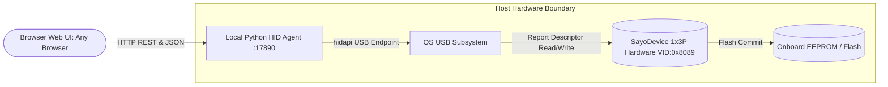

<p align="center"><a href="https://kitsunetechnologies.org/work"></a></p>

# MacroPad Local (kitsune-macropad)

> Cross-browser USB HID configuration tool and local bridge agent for the SayoDevice 1x3P macro pad. Configures keys, function assignments (F13-F24), and onboard flash persistence from any browser—Firefox and Safari included.

<p align="center">
  <a href="https://github.com/KitsuneTech1/kitsune-macropad/releases"></a>
  <a href="https://github.com/KitsuneTech1/kitsune-macropad/actions/workflows/ci.yml"></a>
  <a href="LICENSE"></a>
  <a href="https://www.python.org/downloads/"></a>
  <a href="agent.py"></a>
  <a href="agent.py"></a>
</p>

<p align="center">
  <a href="https://github.com/KitsuneTech1/kitsune-macropad/releases/latest"><strong>📦 Download Latest Release ZIP</strong></a> •
  <a href="#-quick-start-noob-friendly"><strong>⚡ Quick Start Guide</strong></a> •
  <a href="#architecture--usb-hid-bridge"><strong>🔌 Hardware Architecture</strong></a>
</p>

---


## Architecture & USB HID Bridge

Unlike official browser configurators that rely on proprietary WebHID APIs restricted to Chromium, MacroPad Local uses a lightweight local Python background bridge. This decouples hardware USB I/O from the frontend, ensuring compatibility with Firefox, Safari, Chrome, and Edge on Windows, Linux, and macOS.



---

## Features

- **Any Browser Compatible**: Works seamlessly in Firefox, Chrome, Edge, and Safari.
- **Single-Key Remapping**: Click to bind standard keyboard keys (letters, numbers, arrows, numpad, symbols).
- **AutoHotkey (AHK) Integration**: Easily remap keys to extended virtual function keys (`F13` through `F24`) so your own AutoHotkey scripts can intercept them without interfering with standard keys.
- **Onboard Flash Commit**: Saves configurations permanently to device hardware memory.
- **Persistence Verification**: Includes a hardware persistence test that writes sentinel values across USB reconnect cycles to detect counterfeit or read-only firmware.
- **Raw Diagnostic Panel**: Live inspection window shows real-time TX/RX USB HID frames for protocol debugging.

---

## 🚀 Quick Start (Noob-Friendly)

### 1. Download & Launch
1. Download [**MacroPad Local ZIP**](https://github.com/KitsuneTech1/kitsune-macropad/releases/latest) and extract it.
2. Plug your SayoDevice 1x3P macro pad into any USB port.
3. Double-click **`start.bat`** (Windows) or execute `./start.sh` (macOS/Linux).
4. The launcher automatically installs the `hidapi` driver and opens `http://localhost:17890` in your default browser.

### 2. Configure Your Keys
1. Click **Connect** in the browser dashboard.
2. For each of the 3 keys, click **Click to set** and press your desired key, or select **AHK trigger** (F13-F24).
3. Click **Save to device** to commit changes to the onboard memory.

---

## 🧪 Testing & Verification

Run the automated offline unit tests:

```bash
python -m pytest tests
```

Tests cover:
- USB VID/PID device discovery and connection state machines.
- Protocol report serialization and validation.
- Input validation on keycode translation maps.

---

## License

MIT. Copyright (c) 2026 Kitsune Technologies LLC. Full text in [LICENSE](LICENSE).

<p align="center"><sub>Part of <b>Buildtober 2026</b>: 31 open source projects in 31 days. Built by <a href="https://kitsunetechnologies.org/work">Kitsune Technologies</a>. More at <a href="https://github.com/KitsuneTech1">github.com/KitsuneTech1</a>.</sub></p>
